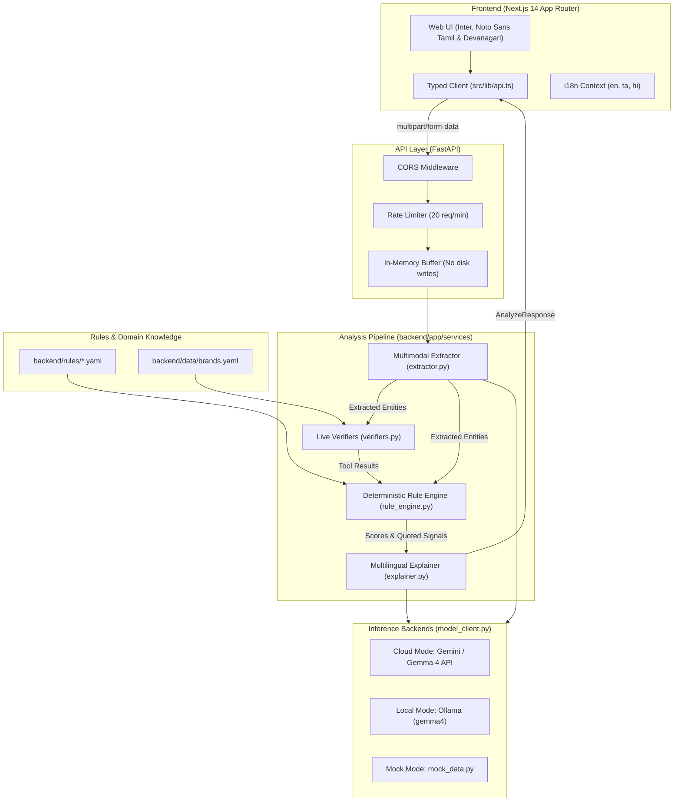

# ScamLens System Architecture

ScamLens is engineered around three non-negotiable architectural tenets:
1. **Separation of Perception and Judgment:** Vision-language models extract entities and explain findings; deterministic rule engines and live verifiers compute scores.
2. **Zero-Persistence Privacy:** Uploaded media and text reside exclusively in volatile memory for the duration of the request and are purged immediately.
3. **Pluggable Multi-tier Execution:** Transparent switching between Cloud inference (Google Gemini / Gemma), Local self-hosted inference (Ollama), and offline Mock development.

---

## 1. High-Level Architecture Diagram

---

## 2. Pipeline Execution Stages

### Stage 1: Ingestion & In-Memory Preprocessing
- Receives `multipart/form-data` containing an optional image binary (PNG, JPEG, WebP) and/or text string.
- If an image is provided:
  - Validates image header and maximum upload size (default: 8 MB) using `Pillow`.
  - Image stays entirely in a Python `io.BytesIO` buffer.
  - Image is converted to RGB / standardized dimensions in-memory.
  - Disk writes are strictly prohibited.

### Stage 2: Multimodal Extraction (`extractor.py` & `model_client.py`)
- Forwards the image buffer and text prompt to the model client (Gemma 4 via Google Gemini Cloud or Ollama Local).
- The model performs OCR and structured entity extraction without assigning any risk score:
  - Document type classification (e.g., `offer_letter`, `courier_sms`, `bank_alert`, `payment_screenshot`).
  - Extracted text verbatim.
  - Senders, URLs, phone numbers, UPI IDs, amounts, and claimed brand names.
  - Image quality assessment (`sharp`, `blurry`, `glitched`).

### Stage 3: Verification Tools (`verifiers.py`)
- Independent network & heuristic checks run concurrently:
  - **URL & Domain Verifier:** Resolves domain age, checks against Google Safe Browsing / URLhaus, checks for homoglyph / typosquatting against `backend/data/brands.yaml`.
  - **UPI Verifier:** Validates VPA structure (merchant vs. personal VPA handle).
  - **Sender Verifier:** Flags free webmail domains claiming to represent banks or tech companies.

### Stage 4: Deterministic Scoring (`rule_engine.py`)
- Evaluates YAML rule packs from `backend/rules/`:
  - `money_demands.yaml`
  - `credentials.yaml`
  - `urgency_threat.yaml`
  - `too_good.yaml`
  - `impersonation.yaml`
  - `links.yaml`
  - `sender.yaml`
  - `payment_screenshot.yaml`
  - `reducers.yaml`
- Rule match requires exact verbatim text presence in `extracted.message_text`.
- Computes raw score (0 to 100) and maps to bands:
  - `0 - 29`: `low_risk` ("No major red flags found")
  - `30 - 59`: `suspicious`
  - `60 - 100`: `likely_scam`
  - `insufficient_info`: if unreadable or lack of signals.

### Stage 5: Multilingual Explanation & Alert Generation (`explainer.py`)
- Transforms structured signals and quoted evidence into empathetic, clear natural language.
- Generates:
  - Human explanation tailored to the requested language (`en`, `ta`, or `hi`).
  - Actionable checklist of next steps (including reporting to 1930 / cybercrime.gov.in).
  - Shareable Family Alert card formatted for messaging apps.

---

## 3. Privacy & Security Architecture

1. **Ephemeral RAM Processing:**
   No uploaded file is stored in a temporary filesystem directory (such as `/tmp` or Windows `%TEMP%`). Image objects are held in memory during request lifecycle and garbage collected.
2. **Local Isolation Mode:**
   In `MODE=local`, zero outgoing network requests are dispatched to external AI APIs. All processing stays confined within the host or container network via Ollama.
3. **CORS & Rate Limiting:**
   FastAPI CORS middleware restricts origins based on `ALLOWED_ORIGINS`. An in-memory sliding window prevents automated scraping and abuse.
